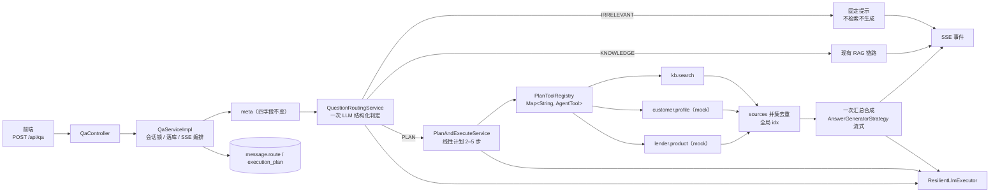
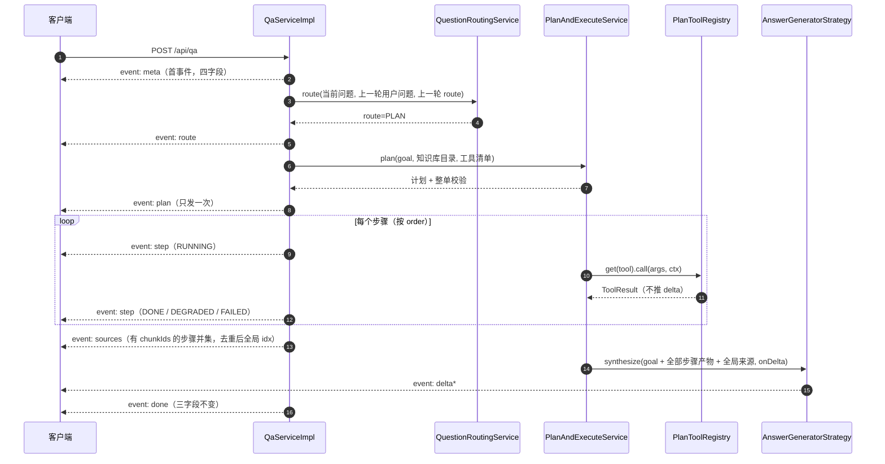
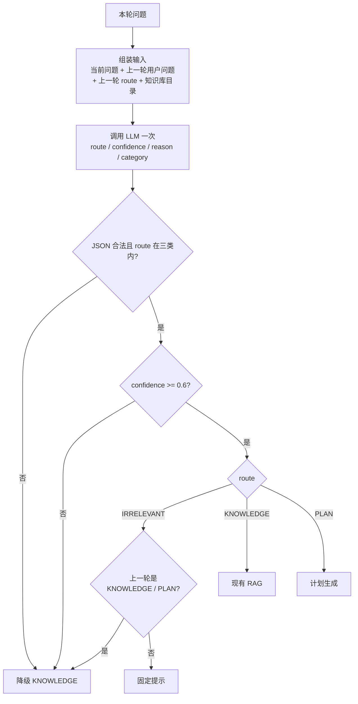
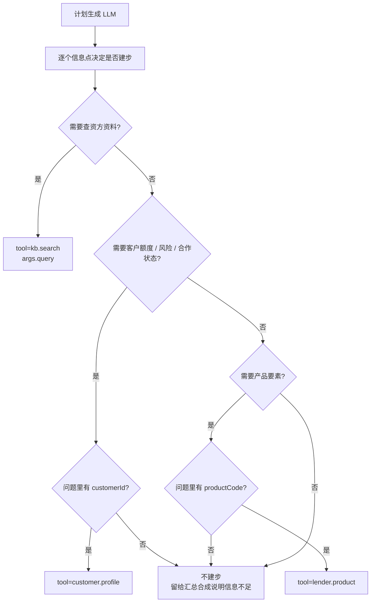

# 问题路由与 Plan-and-Execute · 后端 PRD

> 状态：待评审
> 范围：`lender-assistant` 后端，以及对前端 `lender-assistant-frontend` 的契约影响
> 关联：[multi-turn-backend.md](./multi-turn-backend.md)、[multi-turn-frontend.md](./multi-turn-frontend.md)、ADR-0010 ~ ADR-0014
> 标注约定：**「待评审」= 已给默认值，评审/联调阶段可调**。

## 1. 背景与目标

现有 `POST /api/qa` 把所有问题都当知识库问题：`meta → hybridSearch → sources → 生成 → done`。三个问题：

1. 无关问题（问候、闲聊、越权）也会检索 + 生成，最后只得到「没有检索到相关内容」；
2. 比较、汇总、多跳类问题，单次检索 + 单次生成答不全；
3. 前端看不到系统判成了什么类型、计划怎么做、哪一步没召回。

本 PRD 在现有链路上加两层：

- **问题路由**：每轮先用一次 LLM 结构化判定，输出 `IRRELEVANT` / `KNOWLEDGE` / `PLAN`。
- **Plan-and-Execute**：`PLAN` 问题生成 2–5 步线性计划，每步是**一次确定性工具调用**；全部步骤结束后只做**一次**流式汇总合成。

**非目标**：不做 DAG / 并行；不做模型运行时自主 Function Calling（agent 循环）；不做失败重规划；不做人工编辑计划；不新增问答端点；不改检索算法；不引入 Spring AI；不做多模型路由；**`PLAN` 的计划与合成不使用完整多轮历史，只带上一轮用户问题**（理由见 §5.1）。

## 2. 总体架构



要点：

- 路由、计划、汇总统一经 `ResilientLlmExecutor`，新增 `LlmScene.ROUTE` / `PLAN` / `SYNTHESIS`。
- **执行步只做确定性调用**：`kb.search` 与两个 mock 业务工具都不调用模型；一轮的 LLM 调用恒定为「路由 1 + 计划 1 + 汇总 1」。
- 检索入口仍只有 `SearchService.hybridSearch`；`kb.search` 只是编排层适配器（ADR-0012）。
- 工具调用由代码按计划 `order` 发起，模型不能自行挑工具或加步（ADR-0014）。

## 3. 一次请求的时序（`PLAN`）



`KNOWLEDGE`：`meta → route → sources → delta* → done`。
`IRRELEVANT`：`meta → route → sources([]) → delta(固定提示) → done(sourceCount=0)`。

## 4. 问题路由

### 4.1 输入与输出

每轮调用一次 LLM。输入：`question`、`previousQuestion`（首问 `null`；跳过 `provider="rule"` 的无关轮，见 §4.3）、`previousRoute`、`knowledgeCatalog`（仅 `docId + docTitle`，不放正文）。

```json
{
  "route": "IRRELEVANT | KNOWLEDGE | PLAN",
  "confidence": 0.82,
  "reason": "问题需要跨文档比较",
  "irrelevantCategory": "SMALL_TALK | OUT_OF_SCOPE | UNAUTHORIZED | NONE"
}
```

- `reason` 只落库/落日志，不进 SSE；`irrelevantCategory` 仅用于指标，非 `IRRELEVANT` 时固定 `NONE`。
- **路由值 `PLAN` 与 SSE 事件 `plan` 是两回事**：前者是分类结果，后者是计划事件；两者不要混用命名。
- 路由值不在三类内、JSON 非法、超时、熔断、低置信（`< 0.6`）→ 一律降级 `KNOWLEDGE`（fail-open），**绝不抛异常**。

### 4.2 三分类与边界

| 类型 | 定义 | 处理 |
|---|---|---|
| `IRRELEVANT` | 不需要也不应使用知识库，且与资方接入无关 | 固定提示，不检索不生成 |
| `KNOWLEDGE` | 依据知识库回答，单次检索 + 单次生成可覆盖 | 现有 RAG |
| `PLAN` | 需要多个信息点、跨文档比较/汇总，或先定位再查业务数据 | 线性计划 + 多步执行 |

边界：问候/闲聊/越权 → `IRRELEVANT`；竞品问题看知识库是否有该机构文档，有则 `KNOWLEDGE` 或 `PLAN`，纯外部评价 → `IRRELEVANT`；项目相关但无资料 → `KNOWLEDGE`（要显示「未检索到」，不能与「问错了」混淆）。

**口径取舍**：v1 只有三路由。曾讨论的四分类中，`SIMPLE`（开放域直答）与「无关问题固定提示、不直答」的产品口径冲突，并入 `IRRELEVANT`；`REACT`（模型自主边思考边调工具）本期不做——项目暂无真实业务系统接口，且与 ADR-0012 / ADR-0014 冲突。若未来开放直答或接入业务接口，再单独立项。

### 4.3 追问、固定提示与决策流程

- 每轮都过路由；若判 `IRRELEVANT` 但 `previousRoute` 是 `KNOWLEDGE` / `PLAN`，强制降级 `KNOWLEDGE`，避免「那二套呢」被误杀。
- 无关固定提示由 `rag.routing.irrelevant-reply` 单一控制，默认「我只回答资方接入相关的资料问题，可以换个问法再试试。」；该轮消息 `DONE`、`sources=[]`、`sourceCount=0`、`done.provider="rule"`（非模型生成）。
- **固定提示轮不参与历史回放**：`ConversationHistoryAssembler` 现规则是「USER + ASSISTANT 都 `DONE` 即整轮进上下文」（[ConversationHistoryAssembler.java](file:///e:/project/lender-assistant/src/main/java/com/lender/assistant/conversation/service/ConversationHistoryAssembler.java#L44-L66)），会把固定提示与无关问题一起喂给下一轮检索/生成。为此约定：`provider="rule"` 的轮次整轮跳过，既不做回放，也不作为 `previousQuestion` 来源（`lastUserContent` 同步跳过）。该轮仍正常出现在历史消息接口里。
- **`previousRoute` 取值**：只取最近一条状态 `DONE` 的助手消息的 `route`；若最近一条是 `FAILED` / `STOPPED`，视为无 `previousRoute`（不向前回溯，不做追问继承保护）。
- **mock 模式跳过路由与计划**：`rag.chat.provider=mock` 时不发路由/计划调用，直接走现有 `KNOWLEDGE` 单步链路，事件序列与今天一致（`meta → sources → delta* → done`），**不发** `route` / `plan` / `step`。mock 只保证对话能走通；这三个事件的联调与验收**必须在真实 provider 下进行**。
- 实现形态：`QuestionRoutingService` + `QuestionRoutingServiceImpl`（普通 Service，不建 Strategy）。



## 5. 计划与执行

### 5.1 计划表示

计划是**有序线性列表**，一步 = 一次工具调用。`args` 全部是计划期字面量，执行期不由模型补全。

**计划输入 = 当前问题 + 上一轮用户问题 + 知识库目录 + 工具清单**；`goal` 由此归纳，让「那恒昌呢」这类指代型追问也能抽到正确实体。上一轮用户问题的取法与现有检索完全一致（`ConversationHistoryAssembler.lastUserContent`，[ConversationHistoryAssembler.java](file:///e:/project/lender-assistant/src/main/java/com/lender/assistant/conversation/service/ConversationHistoryAssembler.java#L80-L88)；检索侧拼接见 [SearchServiceImpl.java](file:///e:/project/lender-assistant/src/main/java/com/lender/assistant/rag/service/impl/SearchServiceImpl.java#L88-L90)），不引入新的历史装配。汇总合成仍只用 `goal` + 步骤产物，不带完整多轮历史。

**上一轮与当前轮的分清靠 prompt 分块，不靠步数**。计划 Prompt 骨架：

```text
你是计划器。把「当前问题」拆成 2–5 个确定性工具步骤。

【输入】
上一轮问题（仅用于解析指代，不要并入本轮目标）：{previousQuestion}
当前问题（本轮目标）：{question}
知识库目录：{catalog}
可用工具：{tools}

【规则】
1. 当前问题能独立理解时，忽略上一轮问题。
2. goal 必须是本轮目标，不得并入上一轮话题。
3. 只建信息点步骤，args 用字面量；抽不出 customerId / productCode 就不建该步。
4. 至少一个 kb.search；不要为上一轮已答过的结论重复建步。
输出 JSON：{"goal": "...", "steps": [...]}
```

失败表现是 `goal` 混入上一轮词（如本轮问币种，`goal` 却带上「额度」），或凭空多一步检索上一轮话题；因为 `goal` 会落库、`plan` 事件也会带 `goal`，联调时可直接目视发现。

```json
{
  "goal": "华信单笔代收支持的币种，结合 C10001 的剩余额度给出接入建议",
  "steps": [
    { "stepId": "s1", "order": 1, "title": "检索华信代收支持的币种", "tool": "kb.search",
      "args": { "query": "华信银行单笔代收接口 支持的币种" } },
    { "stepId": "s2", "order": 2, "title": "查询客户 C10001 额度与风险", "tool": "customer.profile",
      "args": { "customerId": "C10001" } }
  ]
}
```

- `order` 从 1 连续递增，`stepId` 形如 `s1`–`sN`，本轮内唯一；步骤数 2–5。
- **至少一个 `kb.search`**：`sources` 与引用体系以知识库命中为锚；纯业务数据问题走 `KNOWLEDGE`，不应进计划。
- **不从问题里抽参数就不建步**：planner 必须从问题中直接得到 `customerId` / `productCode`；抽不出来就不生成该步骤，或让 `args` 缺失 → 校验失败跳过该步（不报错）。
- v1 不设 `dependsOn`：现有工具之间没有依赖关系，字段无实际语义；后续引入依赖型工具（如计算类）时再增加。

### 5.2 工具清单

| `tool` | 作用 | `args` | 产物 | 来源 |
|---|---|---|---|---|
| `kb.search` | 混合检索（`SearchService.hybridSearch`） | `{query ≤200 字, topK? 1–20}` | 命中列表 + `chunkIds` | 真实 |
| `customer.profile` | 按客户号返回授信总额/已用/可用、风险等级、合作状态 | `{customerId: "C\d{5}"}` | 文本摘要 | **mock** |
| `lender.product` | 按产品编码返回费率、期限、放款条件、支持的接口类型 | `{productCode 必填}` | 文本摘要 | **mock** |

- `kb.search` 执行时调用 `hybridSearch(args.query, null, topK)`：`query` 由 planner 结合上一轮问题写成**自包含**查询，不能再把 `previousQuestion` 二次拼进去（否则「恒昌」会被重复，向量与关键词召回都会偏）。
- 两个 mock 工具读 `resources/mock/customer-profiles.json`、`resources/mock/lender-products.json`（本地假数据），**不发真实网络请求、不需要密钥**；实现类名带 `Mock`（`MockCustomerProfileTool` / `MockLenderProductTool`）。
- 开关 `rag.plan.tools.mock-enabled` 默认 `false`（生产关闭）；开启后才注册进 `PlanToolRegistry`，计划 Prompt 里才会出现这两个工具。
- `args` 不合法 → 该步 `FAILED`（`errorCode=ARGS_INVALID`），不抛异常；超时 2s、不重试；`chunkIds` 为空，不影响 `sources` 并集。
- 工具白名单 `rag.plan.allowed-tools` 默认 `kb.search`；开启 mock 后为 `kb.search,customer.profile,lender.product`。

工具判定（计划生成时由同一个 LLM 直接输出 `tool` + `args`，执行期不再判定）：



完整示例（问题「华信银行单笔代收接口支持哪些币种？客户 C10001 的额度还剩多少？结合这两点给接入建议」）：

| 步骤 | `tool` | `args` | 产物 |
|---|---|---|---|
| s1 | `kb.search` | `{"query":"华信银行单笔代收接口 支持的币种"}` | 币种说明片段 + `chunkIds` |
| s2 | `customer.profile` | `{"customerId":"C10001"}` | 「授信 500 万 / 已用 320 万 / 可用 180 万；风险 B；合作中」 |
| 汇总 | 非步骤 | `goal` + 上述两段产物 + 全局来源 | 一段接入建议正文，引用【来源N】 |

### 5.3 计划校验（整单原子）

以下任一不满足 → 整单弃用，发 `plan(degraded=true, goal="", steps=[])`，并按 `KNOWLEDGE` 单步执行：

- 步数不在 `[2,5]`；`tool` 不在白名单；`args` 校验失败；无 `kb.search`；`stepId` / `order` 重复或乱序；JSON 非法 / 超时 / 熔断。

计划调用只在 `route = PLAN` 时发生，经 `ResilientLlmExecutor`（`LlmScene.PLAN`，非流式、可重试）。

### 5.4 执行与失败处理

1. 按 `order` 串行执行全部步骤；每步发 `step(RUNNING)`，结束发 `step(DONE / DEGRADED / FAILED)`；**本阶段不推 `delta`**。
2. **不做重跑、不做重新计划**：某步 `FAILED` 或 `DEGRADED` 只记录结果，继续后续步骤。
3. `kb.search` 零召回 → `DEGRADED`，产物记「资料中未提及」；`kb.search` 异常/超时 → `FAILED`；mock 工具 `args` 非法/超时 → `FAILED`。
4. 汇总合成时把失败/降级步骤原样告知模型（「s2 未召回」「s3 参数非法」），要求回答里**明确说明缺哪块信息**；不编造。
5. 若所有 `kb.search` 都无命中且没有可用业务产物 → 沿用现有「资料库中没有检索到相关内容」提示，`sourceCount=0`。
6. **预算覆盖整轮**：`rag.plan.total-budget-ms`（90s）从**路由调用开始**计时，一直覆盖到**汇总合成结束**；步骤循环、计划重试、路由重试都算在内。实测 SSE 超时是 `QaServiceImpl` 的硬编码常量 120s（[QaServiceImpl.java](file:///e:/project/lender-assistant/src/main/java/com/lender/assistant/rag/service/impl/QaServiceImpl.java#L57-L58)），因此整轮上限 90s 保留 **30s 余量**（≥15s 要求）。
7. **提前收尾**：当剩余预算 < `SYNTHESIS_RESERVE`（20s）时，跳过剩余步骤（`SKIPPED`），立即进入汇总合成；合成超时取 `min(现有问答流超时 60s, 剩余预算)`。这是兜底而非异常：只要合成能产出正文，就正常发 `done`、消息 `DONE`（`execution_plan` 标记 `BUDGET_EXHAUSTED`）；若剩余时间连合成都跑不完 → `error` + `FAILED`。
8. **单步超时**：每步工具调用统一受 `TOOL_TIMEOUT`（10s）约束；mock 工具 2s 在工具内部处理。
9. 路由 / 计划单次非流式调用统一受 `NON_STREAM_CALL_TIMEOUT`（10s）约束，计入同一预算；**现状 `ResilientLlmExecutor` 没有非流式超时**（[ResilientLlmExecutor.java](file:///e:/project/lender-assistant/src/main/java/com/lender/assistant/resilience/ResilientLlmExecutor.java#L20-L21)），该常量需新增实现。

步骤状态（执行态，不写进 `message.status`）：

| 状态 | 含义 | 对最终回答 |
|---|---|---|
| `PENDING` / `RUNNING` | 未开始 / 执行中 | 无 |
| `DONE` | 工具正常返回 | 产物进入合成上下文 |
| `DEGRADED` | `kb.search` 零召回 | 产物「资料中未提及」，合成时说明 |
| `FAILED` | 工具异常、超时、`args` 非法 | 不进入上下文，合成时说明缺失 |
| `SKIPPED` | 预算耗尽 / 客户端断开 | 同上 |

### 5.5 汇总合成（唯一的生成调用）

- `message.content` = 本次合成的完整输出；不拼接多段步骤正文，不插入步骤标题。
- 由 `PlanAndExecuteServiceImpl` 直接调用 `AnswerGeneratorStrategy`，**不是工具**；`AnswerGenerationRequest` 增加 `List<StepOutput> priorStepOutputs`。
- Prompt 组成：公共三铁律 + `goal`；各步骤产物（按 `order`）；全局来源编号表；失败/降级步骤说明。**不带多轮历史**（追问的指代已在 `goal` 与步骤产物中体现）。
- 上下文受 `rag.plan.max-context-chars`（默认 **6000**）截断，从最旧产物开始截断，并置 `execution_plan.contextTruncated=true`。
- 引用一律用全局 `idx`；合成不重试（已推 token）。

## 6. 工具抽象

只保留一个接口、一个结果 record、一个注册表，不建 Factory：

```java
public interface AgentTool {
    String name();
    ToolResult call(Map<String, Object> args, ToolContext ctx);
}

public record ToolResult(boolean ok, String content, List<Long> chunkIds, String errorCode) {
}

public class PlanToolRegistry {
    private final Map<String, AgentTool> tools;

    public PlanToolRegistry(List<AgentTool> tools) {
        this.tools = tools.stream().collect(Collectors.toMap(AgentTool::name, t -> t));
    }

    public Optional<AgentTool> get(String name) {
        return Optional.ofNullable(tools.get(name));
    }
}
```

- `ToolContext` 只带必要字段（`conversationId`、`roundId`、`previousQuestion`、`topK`、`cancellation`）。
- 步骤执行器：`registry.get(step.tool())` 取工具，直接 `call(step.args(), ctx)`；查不到 → 该步 `FAILED`（`TOOL_NOT_FOUND`）。
- 包落位：`AgentTool` / `ToolResult` / `PlanToolRegistry` 放 `rag/tool`，实现放 `rag/tool/impl`（`KbSearchPlanTool`、`MockCustomerProfileTool`、`MockLenderProductTool`）；mock 数据放 `resources/mock/customer-profiles.json`、`resources/mock/lender-products.json`。`tools/` 包（`LenderQueryTools` / `ToolIntentRouter`）仍只承载模型可自主调用的 Function Calling 面，不放计划工具（ADR-0012）。
- 不给工具任何推流能力：没有 `mayStream`、没有 `deltaSink`，流式只发生在汇总合成。
- `mock-enabled=false` 时 mock 工具不注册；计划里出现也不在白名单，整单降级。

## 7. SSE 契约与前端影响

| 事件 | 何时 | 载荷 | 变化 |
|---|---|---|---|
| `meta` | 每轮第一个 | `{conversationId, roundId, userMessageId, assistantMessageId}` | 不变 |
| `route` | `meta` 后、检索前 | `{route, confidence}` | 新增 |
| `plan` | 仅 `PLAN`，**只发一次** | `{degraded, goal, steps:[{stepId, order, title, tool}]}` | 新增 |
| `sources` | 汇总合成前，**只发一次** | 现有数组结构不变 | 多步时为有 `chunkIds` 的步骤并集 |
| `step` | 仅 `PLAN` | `{stepId, status, elapsedMillis}` | 新增；状态含 `SKIPPED` |
| `delta` | 仅汇总合成阶段 | 纯文本 | 只有一段连续流 |
| `done` | 正常结束 | `{provider, elapsedMillis, sourceCount}` | 不变 |

前端影响：

1. 必须忽略未知事件；不要断言「`meta` 后紧跟 `sources`」。
2. `plan` 只来一次，按 `steps` 整体渲染即可；不暴露 `args`，避免泄露参数细节。
3. `step` 只用于进度；不保证每步都出现（预算耗尽时剩余步骤可能直接 `SKIPPED`）。
4. 首个 `delta` 比现状晚，需要用 `step` 表达进度。
5. `sources` 仍先于首个 `delta`，引用面板可照旧渲染；`sourceCount` = 并集长度。
6. `IRRELEVANT` 轮的 `done.provider` 固定为 `"rule"`（固定提示不是模型生成）；若前端把它当模型名展示，需要映射为「规则提示」或隐藏。
7. `mock` 模式（`rag.chat.provider=mock`）跳过路由与计划，**不发** `route` / `plan` / `step`，事件序列与现状一致；这三个事件的联调与验收必须在真实 provider 下进行。

## 8. 数据模型

`message` 新增两个可空 JSONB 列（仅 `ASSISTANT` 行写入，同步 `docs/schema.sql` 与 `COMMENT ON`，ADR-0006）：

```sql
ALTER TABLE message ADD COLUMN IF NOT EXISTS route JSONB;
ALTER TABLE message ADD COLUMN IF NOT EXISTS execution_plan JSONB;
```

`execution_plan` 快照：

```json
{
  "degraded": false,
  "degradedReason": null,
  "provider": "deepseek-chat",
  "elapsedMillis": 380,
  "contextTruncated": false,
  "steps": [
    { "stepId": "s1", "order": 1, "title": "检索币种", "tool": "kb.search",
      "args": { "query": "华信银行单笔代收接口 支持的币种" },
      "status": "DONE", "elapsedMillis": 160,
      "sourceChunkIds": [12, 15], "outputSummary": "命中 5 条，去重后 2 条并入来源", "errorCode": null },
    { "stepId": "s2", "order": 2, "title": "查询客户额度", "tool": "customer.profile",
      "args": { "customerId": "C10001" },
      "status": "DONE", "elapsedMillis": 2,
      "sourceChunkIds": [], "outputSummary": "可用额度 180 万，风险 B，合作中", "errorCode": null }
  ]
}
```

- `outputSummary` 只存摘要；`errorCode` 取 `TOOL_NOT_FOUND` / `ARGS_INVALID` / `TOOL_TIMEOUT` / `TOOL_FAILED` / `TOOL_DEGRADED`。
- `degraded=true` 时填 `degradedReason`（`PLAN_INVALID` / `BUDGET_EXHAUSTED`）。
- `message.sources` 与 SSE `sources` 同构：`chunkId` 去重，按「步骤 `order` + 单步排名」分配全局 `idx`；`sourceCount` = 数组长度。
- 历史消息接口第一阶段不返回这两列（`MessageResponse` 形状不变）。

## 9. 参数与降级

| 参数 | 默认 | 说明 |
|---|---|---|
| `rag.routing.confidence-threshold` | `0.6` | 低于阈值降级 `KNOWLEDGE`；阈值须用评估集校准（§11 P4） |
| `rag.routing.irrelevant-reply` | 见 §4.3 | 固定提示 |
| `rag.plan.min-steps` / `max-steps` | `2` / `5` | 越界降级；上限受整轮预算与 `TOOL_TIMEOUT` 约束 |
| `rag.plan.allowed-tools` | `kb.search` | 白名单；mock 开启后追加两个工具 |
| `rag.plan.tools.mock-enabled` | `false` | 是否注册 mock 业务工具 |
| `rag.plan.total-budget-ms` | `90000` | **唯一超时配置**：整轮预算，路由开始 → 合成结束，含所有调用与重试 |
| `rag.plan.max-context-chars` | `6000` | 合成 Prompt 产物上限 |
| SSE 超时 | `120000` | 代码常量，非新增配置；整轮 90s 结束 → 保留 30s 余量 |

超时默认值收敛为「一个配置项 + 三个代码常量」，不再为路由/计划/步骤/合成分别暴露参数：

| 常量 | 值 | 用途 |
|---|---|---|
| `NON_STREAM_CALL_TIMEOUT` | 10s | 路由与计划的单次非流式调用上限 |
| `TOOL_TIMEOUT` | 10s | 每个步骤的工具调用上限（mock 工具 2s 各自内部处理） |
| `SYNTHESIS_RESERVE` | 20s | 剩余预算低于此值不再开启新步骤，直接进合成 |

合成超时 = `min(现有问答流超时 60s, 剩余预算)`，复用既有能力，不新增参数。

**预算算式**：最坏 `NON_STREAM_CALL_TIMEOUT×2（路由）+ NON_STREAM_CALL_TIMEOUT×2（计划）+ SYNTHESIS_RESERVE = 10×2 + 10×2 + 20 = 60s`，90s 剩 30s；顺利 `10 + 10 + 20 = 40s`，剩 50s，覆盖 5 步 × `TOOL_TIMEOUT`。剩余不足 `SYNTHESIS_RESERVE` 就跳过剩余步骤，是兜底而不是异常。

重试语义：非流式 LLM 调用沿用 `rag.resilience.max-attempts=2`（重试 1 次），检索重试 1 次，都计入整轮预算。

并发约束：`streamExecutor` 现状是硬编码 8 线程 + 队列 100（[QaServiceImpl.java](file:///e:/project/lender-assistant/src/main/java/com/lender/assistant/rag/service/impl/QaServiceImpl.java#L59-L63)）。`PLAN` 轮最长占用一个工作线程约 90s，因此**可同时在跑的问答轮次上限就是 8**；第 9 个起排队，长任务会把等待时间迅速推到 120s SSE 超时。建议把池大小/队列改为配置项（`rag.qa.stream-pool-size` 默认 16、`rag.qa.stream-queue-capacity` 默认 32），并在部署说明里写明「并发会话数 ≈ 池大小」。也不要把队列留到 100：长任务排队等于必然超时。

失败矩阵：

| 失败点 | 处理 | 消息终态 | SSE |
|---|---|---|---|
| 路由超时/熔断/非法/低置信 | 降级 `KNOWLEDGE` | 正常 | `route(KNOWLEDGE)` 后继续 |
| 追问判无关但上一轮知识/计划 | 强制 `KNOWLEDGE` | 正常 | 同上 |
| 计划校验失败/超时/非法 | 放弃计划，降级 `KNOWLEDGE` | 正常 | `plan(degraded=true, steps=[])` |
| 运行期工具查不到 / `args` 非法 | 该步 `FAILED`，继续 | 正常 | `step(FAILED)` |
| `kb.search` 零召回 | `DEGRADED`，继续 | 正常 | `step(DEGRADED)` |
| 预算在步骤边界耗尽 | 剩余 `SKIPPED`，立即合成 | 正常 | `step(SKIPPED)*` |
| 剩余 < `SYNTHESIS_RESERVE` | 强制收尾：跳过剩余步骤，合成超时取预算剩余；能产出正文则正常 `done` | `DONE`（`BUDGET_EXHAUSTED`） | 不发新事件，直接 `sources → delta → done` |
| 剩余时间不足一次合成 | 不发 `done`，停止推送 | `FAILED` | `error` |
| 汇总合成超时/异常 | 停止推送 | `FAILED`（保留已推正文） | `error` |
| 客户端断开 / 线程池拒绝 | 沿用现有语义 | `STOPPED` / `FAILED` | 不再推送 / 500 |

## 10. 成本与可观测

| 路径 | LLM 调用 | 检索/工具 | 备注 |
|---|---|---|---|
| `IRRELEVANT` | 路由 1 | 0 | 比现状更快 |
| `KNOWLEDGE` | 路由 1 + 生成 1 | 1 次 | +0.3–1.5s |
| `PLAN` | **路由 1 + 计划 1 + 汇总 1 = 3** | N 次工具 | 首个 `delta` 更晚；受 90s 预算约束 |

- `LlmScene` 新增 `ROUTE` / `PLAN` / `SYNTHESIS`；工具不写 `llm_call_log`，只写步骤留痕。
- SQL 聚合：路由分布、低置信率、计划步骤数、工具分布与耗时、`DONE/DEGRADED/FAILED/SKIPPED` 比例、每轮 LLM 次数（目标 `PLAN` 轮恒为 3）。
- 日志带 `conversationId` / `roundId` / `stepId` / `tool`。
- 评测集：`resources/eval/routing-evalset.json`（60–100 条三分类）、`resources/eval/plan-evalset.json`（20–30 条复杂问题）。
- 入口：保留 `POST /api/admin/eval/run`（检索）；新增 `POST /api/admin/eval/routing/run`（`type=ROUTING|PLAN`），独立响应 record。

## 11. 分阶段

| 阶段 | 内容 |
|---|---|
| P1 | 路由（`IRRELEVANT` / `KNOWLEDGE`）、`route` 事件、固定提示、`message.route` 落库、追问保护、路由评估集 |
| P2 | `PLAN` 判定、计划生成与整单校验、`PlanToolRegistry` + `kb.search`、`plan` / `step` 事件、执行、`sources` 并集、汇总合成、`execution_plan` 落库 |
| P3 | 两个 mock 业务工具（开关默认关）、工具级超时、预算收尾、失败说明增强 |
| P4 | 路由/计划评估入口；**用路由评估集校准 `confidence-threshold`**（模型自报置信度不可直接当概率，需按评估集的准/误判分布选阈值），再调步骤上限与 `max-context-chars`；计划评估集补一类「指代型追问」用例（如「那恒昌呢」），验收动作为「计划不得引入与当前问题无关的步骤」 |
| P5 | 前端进度展示、联调、端到端回归 |

P2 上线前 `PLAN` 一律按 `KNOWLEDGE` 处理。P3 未上线时 `allowed-tools=kb.search`，计划里出现 mock 工具按白名单外降级。

## 12. 开放问题

1. 路由 Prompt 是否加「上一轮助手回答摘要」；当前只用上一轮用户问题。
2. 知识库目录 >100 份时是否只放 docId 或预筛；当前假设 10–30 份。
3. `route.confidence` 是否对用户可见；当前 SSE 暴露。
4. 全局来源编号是否符合阅读习惯；备选每步独立编号，但破坏 `sources.idx` 语义。
5. `plan` 的 `title` 是否泄露提示词风格；当前只暴露标题。
6. 历史消息接口是否第二阶段返回 `route` / `executionPlan`。
7. `PLAN` 是否改用更便宜/更快的模型。
8. 是否引入 JSON Schema 校验库统一校验 `args`；当前各工具手写。
9. 是否支持工具参数的动态引用（如 `"${s1.output}"`）；第一版只允许字面量，支持它需要模板求值与二次校验。
10. 是否把检索暴露为模型可调用的 `@Tool`；当前只做编排层 `AgentTool`。
11. mock 工具的数据是否要覆盖更多资方与客户；当前各 5–10 条样例。
12. `max-context-chars=6000` 是否够用；取消中间推理步后比较/汇总全压到一次合成，需实测。
13. 指代跨两轮以上时只带上一轮用户问题不够；预期行为是路由回退 `KNOWLEDGE`（该链路有完整多轮历史），本版不解决，也不为 `PLAN` 扩历史。

## 13. 验收标准与实现约束

1. `meta` 首事件四字段、`done` 三字段不变；`plan` 与 `sources` 各只发一次。
2. `IRRELEVANT` 不调用检索与生成；`sources=[]`、`sourceCount=0`、消息 `DONE`、`done.provider="rule"`。
3. `KNOWLEDGE` 除新增 `route` 事件外，行为与现状一致。
4. 路由非法 JSON / 超时 / 熔断 / 低置信 → `KNOWLEDGE`，不发 `error`；路由与计划单次调用超时为 `NON_STREAM_CALL_TIMEOUT`（10s），超时后可重试 1 次。
5. 固定提示轮（`provider="rule"`）不进历史回放、不作为 `previousQuestion`；`FAILED`/`STOPPED` 轮视为无 `previousRoute`。
6. `PLAN` 计划输入含上一轮用户问题；合成不带多轮历史。
7. `PLAN` 的 `plan` 含 2–5 步，`tool` 在白名单；`step` 按 `RUNNING → DONE/DEGRADED/FAILED` 出现；**任何执行步不产生 `delta`**。
8. 计划校验失败 → `plan(degraded=true, steps=[])` 并走 `KNOWLEDGE`。
9. 某步 `FAILED` / `DEGRADED` 不重跑、不中断，后续步骤继续；合成回答明确说明缺哪块信息。
10. 整轮（路由开始 → 合成结束）≤90s；SSE 120s 前至少留 30s；剩余 < `SYNTHESIS_RESERVE`（20s）时强制收尾并仍发 `done`。
11. 多步 `sources` 按 `chunkId` 去重、全局 `idx` 连续；mock 工具不产出来源。
12. 汇总合成超时 → `error` + `FAILED`（保留已推正文）。
13. 客户端断开 → `STOPPED`，会话锁释放。
14. mock 模式跳过路由与计划，直接走 `KNOWLEDGE` 单步链路，**不发** `route` / `plan` / `step`；这三个事件的联调与验收必须在真实 provider 下进行。
15. 历史接口形状不变；`message.route` / `execution_plan` 已落库。
16. `docs/schema.sql` 已同步；空库可启动。
17. 单测不连真库；路由/计划/合成用 stub LLM，不依赖真实 key。
18. `mvn test` 全绿。

**实现约束（一行话说清）**：不引入 Spring AI，沿用 `AnswerGeneratorStrategy` + `ResilientLlmExecutor` + `llm_call_log` 与 Jackson 解析；工具方法签名必须与调用方式一致；`route` 与步骤状态用枚举而不是字符串；未知路由降级不抛异常；方法 ≤40 行、参数 ≤4 个、禁 `var`。
